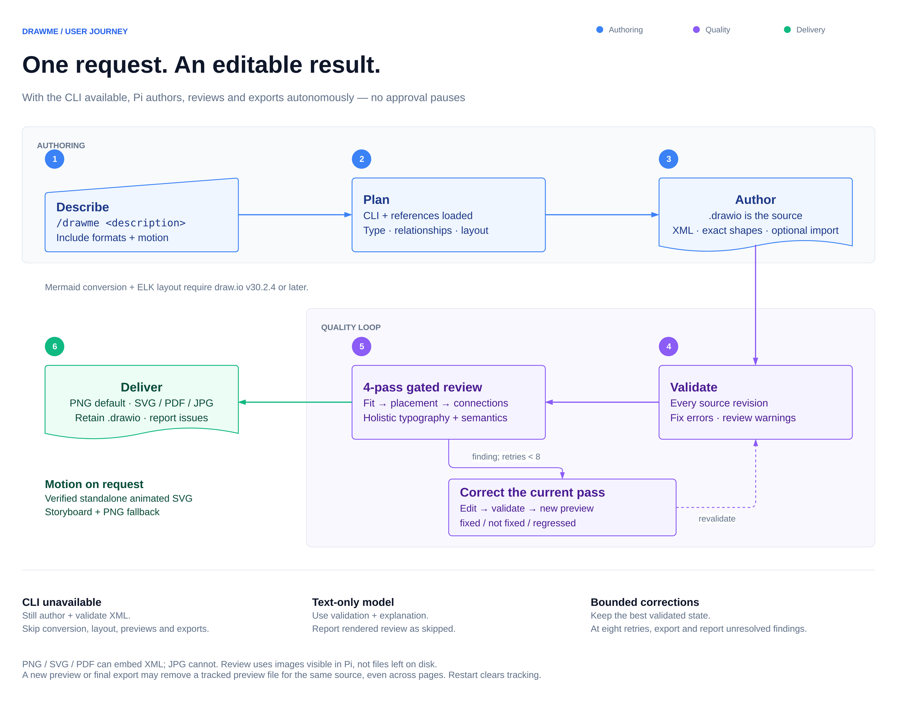
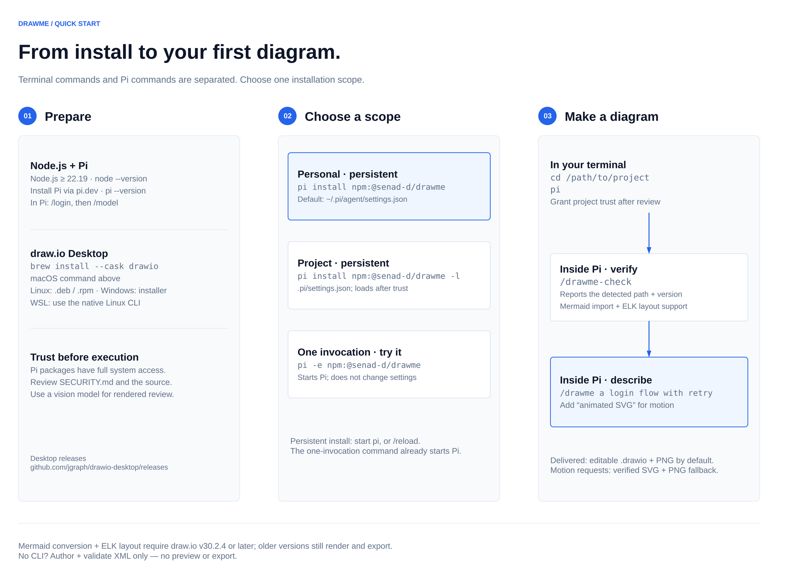

<p align="center">
  
</p>

<p align="center">
  <a href="https://pi.dev"></a>
  <a href="https://www.npmjs.com/package/@senad-d/drawme"></a>
  <a href="https://github.com/senad-d/DrawMe/actions/workflows/ci.yml"></a>
  <a href="https://sonarcloud.io/summary/new_code?id=senad-d_DrawMe"></a>
  <a href="LICENSE"></a>
</p>

<p align="center">
  Natural-language diagrams for <a href="https://pi.dev">pi</a>.
  <br />Turns a description into editable <code>.drawio</code> XML and exports it to PNG / SVG / PDF / JPG, including verified standalone animated SVG.
</p>

---

DrawMe is a native Pi **extension** for diagram authoring. Describe a diagram and Pi plans it, writes editable `.drawio` XML (or converts Mermaid with draw.io 30.2.4 or newer), lints each source revision, reviews the rendered preview when the active model can view images, and exports the final deliverable.

**Privacy:** The draw.io desktop CLI renders and exports locally. Pi sends your requests and model context, including tool results and any attached preview or storyboard images, to the configured model. If you use a hosted model, its provider can receive that content.

<table align="center">
  <tr>
    <th>DrawMe</th>
  </tr>
  <tr>
    <td align="center">
      
    </td>
  </tr>
  <tr>
    <td align="center">
      
    </td>
  </tr>
</table>

- **Natural-language authoring:** flowcharts, architecture, UML, BPMN, ERD, C4, network, ML — as native `.drawio`, or as Mermaid with automatic layout on draw.io 30.2.4 or newer.
- **Guided workflow:** CLI detection, planning, authoring, validation, a gated multi-pass visual review (fit/sizing → element placement → connections → holistic confirmation), and final export run end to end from a single `/drawme` — no approval pauses.
- **Deterministic validation:** a structural linter catches dangling edges, duplicate/reserved ids, malformed geometry, page/container overflow, inadequate margins, conservative readability defects, overlaps, and explicit edge-routing defects before you look at a pixel.
- **Vision-aware previews:** DrawMe attaches verified PNG previews only for models that declare image support. With a text-only or unknown model, the result gives the render path and the workflow reviews structurally instead.
- **Exact shapes, not guesses:** search 10k+ official AWS/Azure/GCP/Cisco/Kubernetes/UML/BPMN styles from a bundled local index.
- **Animated SVG:** pop/slide entrances, connector draw-in, travelling dots, highlights, staggered cascades, persistent connector flow, and portable page sequences export as verified standalone SVG animation, with a storyboard, reduced-motion handling, and a static PNG fallback.
- **Editable source of truth:** final PNG/SVG/PDF exports embed diagram XML by default. DrawMe repairs a missing PNG tail only when the rest of the image is valid.

> **Security:** Pi packages run with your full system permissions. DrawMe reads and writes diagram files and can launch the draw.io CLI or your OS file opener. Review [`SECURITY.md`](SECURITY.md) before installation.

## Table of Contents

- [Implementation Status](#implementation-status)
- [Extension Reference](#extension-reference)
- [Quick Start](#quick-start)
- [Installation](#installation)
- [Commands](#commands)
- [Tools](#tools)
- [Architecture](#architecture)
- [The /drawme Workflow](#the-drawme-workflow)
- [Bundled References and Assets](#bundled-references-and-assets)
- [Requirements and Compatibility](#requirements-and-compatibility)
- [Security](#security)
- [Examples](#examples)
- [Development](#development)
- [Publishing](#publishing)
- [License](#license)

---

## Implementation Status

This checkout implements the DrawMe core loop as a Pi extension:

- Ten model-callable tools (`drawio_check`, `drawio_export`, `drawio_animate`, `drawio_validate`, `drawio_fit_canvas`, `drawio_shapesearch`, `drawio_from_mermaid`, `drawio_layout`, `drawio_explain`, `drawio_open`) and three commands (`/drawme`, `/drawme-check`, `/drawme-export`).
- A guided `/drawme` workflow that steers authoring, validation after every edit, a gated multi-pass visual review, and autonomous final multi-format export.
- Pure-TypeScript structural linting, `-e` PNG IEND repair, shape search over a bundled index, and diagram-to-Markdown description — no Python runtime required.
- draw.io binary resolution across macOS, Linux (including WSL with a native Linux renderer), and Windows, with headless Linux `xvfb-run` handling and version-gated Mermaid conversion and ELK layout.
- A [validation gate](#development) for assets, lint, tests, and package contents.

## Extension Reference

[`docs/reference.md`](docs/reference.md) catalogs the extension's public surface — every command, tool option, default, output behavior, and functional limitation — for other projects and integrations that use DrawMe. It is documentation, not runtime input: the `/drawme` workflow and the registered tool descriptions carry the complete operational instructions themselves.

## Quick Start

### 1) Install the draw.io desktop CLI

```bash
brew install --cask drawio            # macOS
# others: https://github.com/jgraph/drawio-desktop/releases  (Linux: prefer the .deb/.rpm, not snap)
drawio --version
```

### 2) Install the extension

```bash
cd /path/to/your/project
pi install npm:@senad-d/drawme
```

### 3) Start Pi and check the CLI

```bash
pi
```

Inside Pi:

```text
/drawme-check
```

### 4) Draw something

```text
/drawme a flowchart of a user login: enter credentials, validate, then success or retry
```

Pi checks the CLI, plans and writes the `.drawio`, validates every revision, critiques the rendered preview when the active model can view images (or reviews structurally when it cannot), and exports the final editable deliverable — all in one run, without asking for approval along the way.

### Run from a source checkout

```bash
git clone https://github.com/senad-d/DrawMe.git
cd DrawMe
npm ci --ignore-scripts
npm run validate
pi --no-extensions -e .
```

## Installation

| Scope | Command | Notes |
| --- | --- | --- |
| Global | `pi install npm:@senad-d/drawme` | Loads in every trusted Pi project. |
| Project-local | `pi install npm:@senad-d/drawme -l` | Writes to `.pi/settings.json` in the current project. |
| One run | `pi -e npm:@senad-d/drawme` | Try without changing settings. |
| Git | `pi install git:https://github.com/senad-d/DrawMe.git` | Install from Git; pin a tag or commit for a fixed version. |
| Local checkout | `pi --no-extensions -e .` | Develop or test this repository. |

## Commands

| Command | Description |
| --- | --- |
| `/drawme <description>` | Start authoring, per-edit validation, multi-pass visual review, and final export. If Pi is busy, the request queues as a follow-up. |
| `/drawme-check` | Report the detected draw.io CLI path and version and whether Mermaid conversion and ELK layout are supported, or report why the CLI is unavailable. |
| `/drawme-export <file> [png\|svg\|animated-svg\|pdf\|jpg]` | One-shot final export. `animated-svg` verifies native connector flow or a supported page sequence. For stored DrawMe motion, [call `drawio_animate` without `steps`](docs/reference.md#drawio_animate). |

## Tools

Registered for the model to call directly.

| Tool | Purpose |
| --- | --- |
| `drawio_check` | Resolve the draw.io binary and version, and report Mermaid import and ELK layout support. |
| `drawio_export` | Export a `.drawio` to PNG/SVG/PDF/JPG. `animated:true` requires a final SVG and verifies native connector flow or a portable page sequence. A PNG preview is unembedded and capped on both axes. See the [export reference](docs/reference.md#mode-and-naming-behavior) for image attachments, sizing, and cleanup. |
| `drawio_animate` | Add or reuse stored motion (pop and slide entrances, connector draw-in, travelling dots, highlights, dimming, staggered cascades) on an existing page. Export a verified animated SVG and an optional storyboard sampled from the visual batches. |
| `drawio_validate` | Deterministic lint for XML structure, geometry, page/container bounds, margins, overlap, explicit route-through/crossings, anchors facing away from their route, edge-label collisions, labels on connector lines, small fonts, and unchecked auto-routes. Likely direct-path obstructions for auto-routed edges are preview-review observations. The readability score reports route-through, crossings, overlaps, and anchors separately. |
| `drawio_fit_canvas` | Fit each page's canvas to its content plus a margin (default 40px): grows cramped pages, tightens oversized ones, and shifts content to the margin origin — instead of shrinking or cramming elements. Deterministic, no CLI. |
| `drawio_shapesearch` | Exact official `style=` strings for 10k+ AWS/Azure/GCP/Cisco/Kubernetes/UML/BPMN shapes, from a bundled local index. Use instead of guessing a style. |
| `drawio_from_mermaid` | Convert either inline Mermaid text or a `.mmd` file to a native `.drawio` with automatic layout. Requires draw.io **30.2.4 or newer**. |
| `drawio_layout` | Re-place nodes / route edges with an ELK preset (`verticalFlow`, `horizontalFlow`, `verticalTree`, `horizontalTree`, `radialTree`, `organic`) for large graphs. Requires draw.io **30.2.4 or newer**. |
| `drawio_explain` | Describe an existing `.drawio` as structured Markdown (components by container, relations) — for READMEs/PR summaries or model read-back. |
| `drawio_open` | Open a `.drawio`/export in the OS default app (draw.io desktop) for fine-tuning. |

## Architecture

```text
Natural-language request
  └── Pi agent
        └── DrawMe extension  (check · validate · export · shape search · Mermaid · layout · explain · open)
              └── draw.io desktop CLI  (renders and exports, local process)
                    └── Deliverables: .drawio source + PNG / SVG (static or animated) / PDF / JPG
```

The extension factory in `src/index.ts` registers the tools and commands. Rendering, conversion, and layout launch the draw.io CLI on demand with an argument list rather than a shell; validation, shape search, and explanation run directly in the extension.

## The /drawme Workflow

`/drawme` injects a guided nine-step workflow that the model follows using the tools above:

1. **Check** — the command itself resolves the CLI and embeds the result plus the authoring references into the workflow message (including Mermaid conversion and ELK layout availability), so the run starts with everything in context — no upfront tool calls or file reads.
2. **Plan** — pick the diagram type, relationships, finite canvas, and layout direction; motion requests plan an animated SVG plus a static fallback.
3. **Author** — write editable uncompressed XML (or convert Mermaid when supported), using exact searched shapes and optional ELK layout. Animation may use persistent connector flow and portable page-root JSON sequences.
4. **Validate after every edit** — fix all errors; fix each warning or record why it is reviewed and acceptable. An incomplete validation is blocking. Malformed animation, dangling targets, invalid timing, and standalone-SVG-incompatible effects are diagnosed before export.
5. **Visual review in gated passes** — the model reviews each relevant page using its attached preview, when available. Three focused passes ask: **fit and sizing** (does the diagram fit its page; does the canvas or an element need resizing), **element placement** (is every element positioned correctly; is there a visibly better arrangement), and **connections** (is every connection correct, cleanly routed, symmetric where the layout is symmetric, and anchored to the middle of the facing element side where possible). A fourth **holistic pass** reads every label word for word, checks contrast, semantics, and the diagram type's own review checklist, and re-checks the earlier passes for regressions. Concrete defects to hunt (overlapping or clipped text, labels struck through by lines, floating endpoints, edges through unrelated shapes, …) are spelled out per pass, and each finding lands in a numbered ledger naming the affected cells and planned fix. Without the image, the model reviews structurally with validation and explanation instead of describing renders.
6. **Fix and verify before the next pass** — make targeted edits, validate, and render a replacement preview. Compare it with the prior same-page image only if Pi still shows that image to the model; otherwise review the new image on its own. Record a verdict (fixed / not fixed / regressed) for each addressed finding. Clear the current pass before moving on, unless the correction limit has been reached.
7. **Bound corrections** — pass inspection previews do not count as retries; permit at most eight targeted edit → validation → replacement-preview correction retries total. If a finding is still open at the limit, the run keeps the best validated state, finishes the remaining passes as inspection-only, continues to final export, and names the unresolved finding, its pass, and its last verdict in the report; `drawio_open` is offered afterwards for manual fine-tuning.
8. **No human gate** — the run never pauses for approval or feedback; if the user interrupts with feedback, it is handled as new critique findings and the run continues.
9. **Final export** — immediately after the holistic confirmation, export requested embedded/editable formats (each page of a multi-page file separately). Motion requests use `drawio_animate` for stored DrawMe motion, or `drawio_export` with `animated:true` for native connector flow or a supported page sequence, normally with a static PNG fallback. Final export reports deliverables, animation verification, unresolved findings, and preview cleanup warnings.

Deterministic checks cover XML contracts, IDs/references, finite page and container bounds, outer margins, overlaps, explicit waypoint routes, edge-label placement, conservative font/wrapping cases, and pinned anchors that face away from their adjacent waypoint or auto-routed peer. Auto-routed edges remain renderer-dependent: validation warns that their route is unchecked and adds a focused observation when the direct connection line pierces a shape, but the preview remains the final arbiter. Rendered clipping and wrapping, contrast, typography at full-diagram scale, visual balance, semantics, and draw.io's automatic connector routes can only be judged from the preview image, so they are critiqued when the active model can view images and reported as unverified when it cannot. Vision's job in the loop is to narrow every rendered defect down to specific cells (the authoring reference maps each defect to a source fix) and then to confirm from the replacement image that the defect is actually gone. A 2000px preview that makes labels unreadable requires a tighter/simpler layout, page splitting, or a focused re-export — it must never be accepted as-is.

## Bundled References and Assets

These stay plain Markdown files for easy editing. `/drawme` embeds the diagram-types, XML-authoring, style-presets, and (when supported) Mermaid references directly into its workflow message, so the model starts with them in context; the troubleshooting reference is read on demand when an export fails.

- `docs/reference.md` — catalog of commands, tool options, defaults, output behavior, and limitations (documentation only; not read at runtime).
- `assets/references/xml-authoring.md` — `.drawio` skeleton, cell/edge forms, containers, palette, spacing.
- `assets/references/diagram-types.md` — per-type presets (ERD, UML, sequence, C4, architecture, ML, flowchart, SysML, BPMN, network, swimlane).
- `assets/references/style-presets.md` — Light, Dark, and Multi-color themes.
- `assets/references/mermaid-authoring.md` — Mermaid authoring for the Mermaid conversion path.
- `assets/references/troubleshooting.md` — export/render failure recovery.
- `assets/data/shape-index.json.gz` — the vendored draw.io shape index behind `drawio_shapesearch` (see its notice).

## Requirements and Compatibility

- **Node.js** ≥ 22.19.
- **draw.io desktop CLI** on PATH or in a known installation location. In WSL, install the native Linux renderer; DrawMe does not use the Windows `.exe` from WSL. See [CLI discovery](docs/reference.md#drawio_check) for custom installations.
- **draw.io 30.2.4 or newer** for `drawio_from_mermaid` and `drawio_layout`. Older versions can still render ordinary exports.
- **Linux:** Run Pi as an unprivileged user. For headless use, install Xvfb with `xvfb-run`; DrawMe uses it for discovery and rendering when no display is present.

## Security

DrawMe works with diagram files and may launch the draw.io CLI, `xvfb-run` on headless Linux, or the OS
[file opener](docs/reference.md#drawio_open). Pi extensions inherit the permissions of the Pi process, so
install only packages you trust. See [`SECURITY.md`](SECURITY.md) for runtime and dependency details.

## Examples

Editable sources and rendered examples live in [the example index](https://github.com/senad-d/DrawMe/blob/main/example/README.md). The showcase spans three presets: **Multi-color** for the user journey (blue authoring, purple quality, green delivery), **Dark** for the animated AWS architecture, and **Light** for the installation and reference diagrams. All use deliberate typography, native shapes, generous spacing, and explicitly routed connectors.

| Example | Editable source | Render |
| --- | --- | --- |
| Multi-color user journey, four review passes, and CLI/vision fallbacks | [Source](example/drawme-how-it-works.drawio) | [PNG](https://github.com/senad-d/DrawMe/blob/main/example/drawme-how-it-works.drawio.png) |
| Light installation guide: scopes, trust, CLI check, and first request | [Source](example/drawme-installation-guide.drawio) | [PNG](https://github.com/senad-d/DrawMe/blob/main/example/drawme-installation-guide.drawio.png) |
| Architecture and responsibilities of all ten tools | [Source](example/drawme-architecture.drawio) | [PNG](https://github.com/senad-d/DrawMe/blob/main/example/drawme-architecture.drawio.png) |
| Structural gates and bounded, pass-by-pass correction | [Source](example/drawme-validation-decision-tree.drawio) | [PNG](https://github.com/senad-d/DrawMe/blob/main/example/drawme-validation-decision-tree.drawio.png) |
| Dark AWS architecture: transactional outbox, SNS/SQS fan-out, consumers, and dead letters | [Source](example/event-driven-orders.drawio) | [Animated SVG](https://github.com/senad-d/DrawMe/blob/main/example/event-driven-orders.animated.svg) · [PNG](https://github.com/senad-d/DrawMe/blob/main/example/event-driven-orders.drawio.png) · [Storyboard](https://github.com/senad-d/DrawMe/blob/main/example/event-driven-orders.storyboard.png) |
| Git branching and merges (classic, retained example) | [Source](example/git-graph-example.drawio) | [PNG](https://github.com/senad-d/DrawMe/blob/main/example/git-graph-example.drawio.png) |

### Animated example — Dark

<p align="center">
  
</p>

This Dark-theme showcase uses 13 official AWS4 components across four zones, including API Gateway, Lambda, DynamoDB, SNS, SQS, and SES. Its verified standalone SVG demonstrates pop/slide entrances, connector draw-in, travelling dots, highlights, and staggered reveals in a 12.56-second loop. Reduced-motion viewers see the static diagram. If your SVG host sanitizes animation, use the [PNG fallback](https://github.com/senad-d/DrawMe/blob/main/example/event-driven-orders.drawio.png). The [storyboard](https://github.com/senad-d/DrawMe/blob/main/example/event-driven-orders.storyboard.png) samples the ends of visual batches to show order and visibility, not playback. To re-export this example's stored motion, call `drawio_animate({ "input": "example/event-driven-orders.drawio" })`.

## Development

```bash
npm ci --ignore-scripts   # install the locked dependency set
npm run validate          # check:golden → lint → test → check:pack
```

Individual checks:

```bash
npm run typecheck         # tsc --noEmit
npm run lint:eslint       # eslint . --max-warnings=0
npm run format:check      # LF endings, no trailing whitespace, final newline, valid JSON
npm run check:golden      # SHA-256 integrity of bundled assets
npm run check:pack        # verify the npm package contents without publishing
npm test                  # vitest run
npm run coverage          # vitest run --coverage
pi --no-extensions -e .   # load this checkout in Pi
```

Source layout:

- `src/index.ts` — registers the tools and commands.
- `src/drawio.ts` — binary resolution, a pure/testable export planner, the CLI runner, Mermaid conversion, ELK layout, and file-open.
- `src/animation.ts` — native animation analysis, portable page-sequence compilation, reduced-motion CSS, and animated-SVG verification.
- `src/validate.ts` — structural and animation linter.
- `src/shapesearch.ts` — shape search over the bundled index.
- `src/explain.ts` — diagram-to-Markdown describer.
- `src/dom.ts` — shared xmldom helpers used by `validate`/`explain`.
- `src/png.ts` — `-e` PNG IEND repair.
- `src/workflow.ts` — the guidance `/drawme` injects.

## Publishing

DrawMe publishes to npm as `@senad-d/drawme` through the [Publish to npm workflow](https://github.com/senad-d/DrawMe/actions/workflows/publish.yml). Run `npm run validate` locally, land the release version on the default branch, then dispatch the workflow from that exact branch, not a tag, and choose the npm dist-tag. The workflow validates the selected commit before the publish job can use npm trusted publishing or push the release tag.

Before dispatching, restrict the GitHub `npm` environment's deployment policy to the exact default branch with no tag deployment rules. This policy is set in repository settings, outside the workflow; recheck it if the default branch changes.

## License

MIT — see [`LICENSE`](LICENSE).
